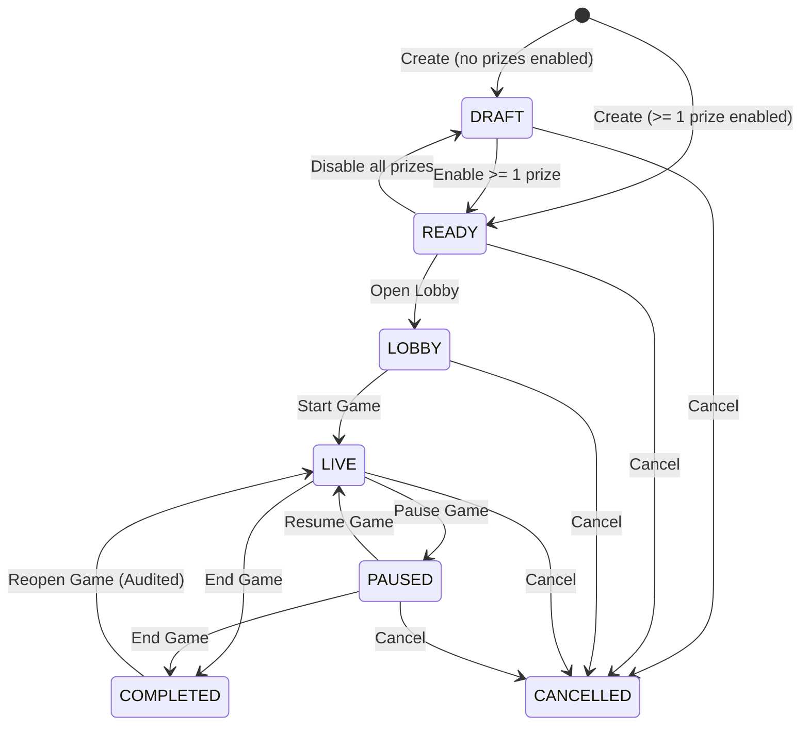

# Housie / Tambola Game-Control Platform Architecture

## 1. Executive Summary & System Overview

The Housie platform is a production-grade, digital game-control system purpose-built for real-world live events (weddings, corporate celebrations, kitty parties, club gatherings, and social fundraisers). In this physical-ticket paradigm:
- Tickets are **physically printed outside the platform** and distributed offline.
- The platform acts as the **central event conductor**:
  - Sets up game economics (tickets distributed, sold, complimentary, pricing in paise).
  - Configures game prize categories (First Five, Lines, Corners, Full Houses, Custom categories).
  - Conducts cryptographically secure, random number calling (1–90) via server-side `crypto.randomInt`.
  - Enforces single-game row locks to serialize state transitions, undos, and calls.
  - Broadcasts realtime updates via Socket.IO across display/projector screens and spectator devices.
  - Empowers hosts with a mobile-first, one-handed control panel to manage calling, claims, verification, and rejections.
  - Preserves an immutable, append-only audit trail in PostgreSQL enforced by database triggers.

---

## 2. Monorepo & Technology Stack

```
housie/
├── apps/
│   ├── api/                 # Node.js + Express + TypeScript + Prisma + Socket.IO
│   │   ├── prisma/
│   │   │   ├── schema.prisma
│   │   │   ├── migrations/
│   │   │   └── seed.ts
│   │   └── src/
│   │       ├── config/      # Zod-validated environment config
│   │       ├── lib/         # Prisma client, Redis client, Pino logger
│   │       ├── middleware/  # Auth, ownership, rate limiting, error handling
│   │       ├── modules/     # auth, games, prizes, calling, winners, audit
│   │       ├── realtime/    # Socket.IO server, Redis adapter, rooms, events
│   │       ├── app.ts
│   │       └── server.ts
│   └── web/                 # Next.js (App Router), React 19, TypeScript, Tailwind CSS, Framer Motion
│       └── src/
│           ├── app/         # App router pages: login, signup, dashboard, games, display, play
│           ├── components/  # board, ball, host, display, common UI
│           ├── hooks/       # useGameSocket, useAudio, useGameState
│           └── lib/         # API client, speech synthesis, socket client
├── packages/
│   └── shared/              # Shared types, Zod schemas, state machine, number-to-words (EN & HI)
├── docker-compose.yml       # Dev Postgres 16 + Redis 7
├── .github/workflows/ci.yml # GitHub Actions pipeline
├── docs/
│   ├── ARCHITECTURE.md
│   └── DECISIONS.md
└── package.json / turbo.json / pnpm-workspace.yaml
```

### Key Technical Choices
- **Monorepo Management**: `pnpm workspaces` + `Turborepo` for fast cached builds and dependency isolation.
- **Language**: TypeScript Strict (`"strict": true`, `"noImplicitAny": true`, `"exactOptionalPropertyTypes": true`).
- **Backend**: Express + Node.js 20+ with Prisma ORM.
- **Frontend**: Next.js (App Router), Tailwind CSS for styling, Framer Motion for high-impact visual ball pops and board flips.
- **Database**: PostgreSQL 16 (single source of truth; transactional row-level locking with `FOR UPDATE`).
- **Realtime / Cache**: Socket.IO with `@socket.io/redis-adapter` for horizontal scalability; Redis for rate limiting and state snapshot caching (fail-open if Redis is unreachable).
- **Audio Engine**: Web Speech API (`speechSynthesis`) with dedicated Hindi (hi-IN) and English voice fallback routines, coupled with a complete lookup dictionary (1–90) in `packages/shared`.

---

## 3. User Flows & Operational Journeys

```mermaid
sequenceDiagram
    autonumber
    actor Host as Host (Phone / Laptop)
    actor TV as Display Screen (TV / Projector)
    actor Spectator as Spectator (Mobile Play Link)
    participant API as API Server (Express + Prisma)
    participant Redis as Redis Pub/Sub
    participant DB as PostgreSQL (SSOT)

    Host->>API: POST /games (Create game, set ticket economics)
    Host->>API: PATCH /games/:id/prizes (Configure First 5, Lines, Full Houses)
    Host->>API: POST /games/:id/lobby (Move game to LOBBY)
    Host->>TV: Open /game/:gameId/display?t=token (Full screen on projector)
    TV->>API: Handshake Socket (joins room game:{id}:public)
    Spectator->>API: Open /play/:gameCode (joins room game:{id}:public)
    
    Host->>API: POST /games/:id/start (Move to LIVE)
    API->>DB: UPDATE games SET status='LIVE' (Audit: GAME_STARTED)
    API-->>Redis: Broadcast game:status (LIVE)
    Redis-->>TV: game:status (LIVE)
    Redis-->>Spectator: game:status (LIVE)

    loop Number Calling
        Host->>API: POST /games/:id/call (Header: Idempotency-Key)
        API->>DB: BEGIN TX; SELECT FOR UPDATE; pick random remaining; INSERT called_number; version++; COMMIT;
        API-->>Redis: Broadcast number:called { number, sequence, words }
        Redis-->>TV: number:called (Animate ball pop, flip board cell, speak audio)
        Redis-->>Spectator: number:called (Update board, last 5 numbers)
        Redis-->>Host: number:called (Update counters, ball display)
    end

    opt Physical Ticket Claim & Winner Verification
        Host->>API: POST /games/:id/winners (Claim: Player X, Ticket #42, Prize Top Line)
        API->>DB: INSERT winner (Status: CLAIMED, atSequence: current)
        API-->>Host: winner:claimed
        Host->>API: POST /games/:id/winners/:id/verify
        API->>DB: BEGIN TX; SELECT FOR UPDATE; Check duplicate/limits; UPDATE winner (VERIFIED); Check prize completion; COMMIT;
        API-->>Redis: Broadcast winner:verified (Public)
        Redis-->>TV: Winner celebratory overlay (6s fanfare)
    end

    Host->>API: POST /games/:id/end
    API->>DB: UPDATE games SET status='COMPLETED' (Audit: GAME_COMPLETED)
    API-->>Redis: Broadcast game:status (COMPLETED)
    Host->>API: GET /games/:id/summary (Review economics, winners, audit logs)
```

### Primary Personas
1. **The Event Host**:
   - Manages physical tickets distributed, complimentary, and sold.
   - Triggers server-side number generation via a massive, one-handed touch button.
   - Inspects claimed ticket numbers against the numbers called at that point in time (`atSequence`).
   - Verifies or rejects claims with immediate prize-quota auto-completion.
2. **The Audience / Projector Display**:
   - Distraction-free, zero-control TV/projector view.
   - Giant high-contrast animated number ball with bilingual text (English + Hindi).
   - Dynamic 90-number grid with pulsing indicator on latest call.
   - Fullscreen celebration modal triggered instantly on winner verification.
3. **Spectators (Mobile Play View)**:
   - Guests tracking called numbers on their phones via `/play/:code` without installing an app.
   - Synchronized with the projector in realtime.

---

## 4. Screens & Information Architecture

| Route | Purpose | Key Components |
|---|---|---|
| `/login` & `/signup` | Host authentication | Form with client/server Zod validation, error banners, auth cookie reception. |
| `/dashboard` | Host overview | Metric cards (total games, revenue, active sessions), game history table with status chips, "Create New Game" CTA. |
| `/games/new` | Initial setup wizard | Form for event name, venue, event date, ticket price (INR paise), total physical tickets printed, description. Computes short code & unguessable display token. |
| `/games/:id/setup` | Economics & Prizes | Physical ticket counts (sold, complimentary, unsold), revenue projection, prize categories table (toggle, prize name, prize amount in ₹, max winners, add custom). |
| `/games/:id/lobby` | Pre-game staging | Big Game Code display, QR code linking to `/play/:code`, "Launch Projector Display" link, Start Game CTA. |
| `/games/:id/host` | Mobile-first Game Control | Top sticky number ball (latest call), counters (Called X/90, Remaining Y), 1-90 board tab, Categories & Claims tab with claim verification form, Audit log tab, thumb-zone "CALL NEXT NUMBER" fixed bottom bar, Undo & Pause buttons. |
| `/game/:gameId/display?t=token` | Projector / TV Screen | Dark-mode canvas, giant animated ball with words (EN/HI), 9x10 grid with latest pulse, "Last 5 Numbers" tape, Category status tags, 6-second celebratory Winner Modal, sound-gate prompt. |
| `/play/:gameCode` | Read-only Spectator View | Clean responsive spectator view with active called grid, last called numbers, prize status, no host controls. |
| `/games/:id/summary` | Post-game Debrief | Full event metrics (tickets, revenue, prize pool, payout balance), winners roster with paid toggles, chronological audit log inspection. |

---

## 5. Entity Relationship Diagram (PostgreSQL)

```mermaid
erDiagram
    users ||--o{ sessions : has
    users ||--o{ games : hosts
    games ||--|| game_settings : configures
    games ||--o{ game_prizes : offers
    games ||--o{ called_numbers : records
    games ||--o{ winners : validates
    games ||--o{ game_players : registers
    games ||--o{ audit_logs : logs
    game_prizes ||--o{ winners : awarded_to

    users {
        uuid id PK
        varchar email UK
        varchar passwordHash
        varchar name
        timestamptz createdAt
        timestamptz updatedAt
    }

    sessions {
        uuid id PK
        uuid userId FK
        varchar refreshTokenHash
        varchar userAgent
        varchar ip
        timestamptz expiresAt
        timestamptz revokedAt
        timestamptz createdAt
        timestamptz updatedAt
    }

    games {
        uuid id PK
        uuid hostId FK
        varchar name
        varchar venue
        date eventDate
        text description
        varchar code UK
        varchar displayToken UK
        enum status
        integer ticketPrice
        integer totalTickets
        integer ticketsDistributed
        integer ticketsSold
        integer ticketsComplimentary
        timestamptz startedAt
        timestamptz pausedAt
        timestamptz endedAt
        integer version
        timestamptz createdAt
        timestamptz updatedAt
    }

    game_settings {
        uuid gameId PK_FK
        boolean soundEnabled
        enum voiceMode
        integer volume
        timestamptz createdAt
        timestamptz updatedAt
    }

    game_prizes {
        uuid id PK
        uuid gameId FK
        enum key
        varchar name
        varchar prizeName
        integer prizeAmount
        integer maxWinners
        enum status
        integer sortOrder
        boolean isCustom
        timestamptz createdAt
        timestamptz updatedAt
    }

    called_numbers {
        uuid id PK
        uuid gameId FK
        smallint number
        smallint sequence
        timestamptz calledAt
        timestamptz undoneAt
        uuid calledById FK
        boolean isManual
    }

    winners {
        uuid id PK
        uuid gameId FK
        uuid prizeId FK
        varchar playerName
        varchar ticketNumber
        text notes
        enum status
        timestamptz claimedAt
        timestamptz resolvedAt
        uuid resolvedById FK
        smallint atSequence
        timestamptz paidAt
        uuid paidById FK
        timestamptz createdAt
        timestamptz updatedAt
    }

    game_players {
        uuid id PK
        uuid gameId FK
        varchar name
        timestamptz joinedAt
    }

    audit_logs {
        bigserial id PK
        uuid gameId FK
        uuid actorId FK
        enum action
        jsonb data
        timestamptz createdAt
    }
```

### Essential Database Constraints & Triggers
1. **Partial Unique Indexes for Numbers**:
   ```sql
   CREATE UNIQUE INDEX idx_called_numbers_game_num_active 
     ON called_numbers (game_id, number) WHERE undone_at IS NULL;

   CREATE UNIQUE INDEX idx_called_numbers_game_seq_active 
     ON called_numbers (game_id, sequence) WHERE undone_at IS NULL;
   ```
2. **Immutable Append-Only Audit Log Trigger**:
   ```sql
   CREATE OR REPLACE FUNCTION audit_logs_prevent_mutation()
   RETURNS TRIGGER AS $$
   BEGIN
       RAISE EXCEPTION 'audit_logs is append-only: UPDATE and DELETE operations are prohibited';
   END;
   $$ LANGUAGE plpgsql;

   CREATE TRIGGER trg_audit_logs_append_only
   BEFORE UPDATE OR DELETE ON audit_logs
   FOR EACH ROW EXECUTE FUNCTION audit_logs_prevent_mutation();
   ```
3. **Winner Ticket Uniqueness**:
   A single physical ticket cannot have two VERIFIED wins for the exact same prize category:
   ```sql
   CREATE UNIQUE INDEX idx_winners_unique_verified_prize_ticket 
     ON winners (game_id, prize_id, ticket_number) 
     WHERE status = 'VERIFIED';
   ```

---

## 6. Complete REST API Specification

All endpoints are prefixed with `/api`. Error responses follow the uniform standard:
```json
{
  "error": {
    "code": "ERROR_CODE",
    "message": "Human readable message",
    "details": {}
  }
}
```

### 6.1 Authentication (`/api/auth`)
- `POST /api/auth/signup`: Create host account `{ email, password, name }`. Returns `{ user }`, sets httpOnly auth & refresh cookies.
- `POST /api/auth/login`: Authenticate `{ email, password }`. Rate-limited per IP & email. Sets cookies.
- `POST /api/auth/logout`: Revokes active session, clears cookies.
- `POST /api/auth/refresh`: Issues new access token using valid rotating refresh token cookie.
- `GET /api/auth/me`: Validates session, returns current user profile `{ user: { id, email, name } }`.

### 6.2 Games Management (`/api/games`)
- `POST /api/games`: Create new game `{ name, venue, eventDate, ticketPrice, totalTickets, description }`. Automatically generates unique short code & unguessable `displayToken`, populates default prizes & game_settings. Returns game object.
- `GET /api/games`: Paginated list of games hosted by current user `{ page, limit, status }`.
- `GET /api/games/:id`: Fetch game details (enforces host ownership; returns 404 for unauthorized games).
- `PATCH /api/games/:id`: Update basic details `{ name, venue, eventDate, description }`.
- `PATCH /api/games/:id/tickets`: Update ticket economics `{ ticketsDistributed, ticketsSold, ticketsComplimentary, ticketPrice }`.
- `PATCH /api/games/:id/settings`: Update audio settings `{ soundEnabled, voiceMode, volume }`.
- `POST /api/games/:id/lobby`: Move status DRAFT/READY -> LOBBY.
- `POST /api/games/:id/start`: Move status LOBBY -> LIVE.
- `POST /api/games/:id/pause`: Move status LIVE -> PAUSED.
- `POST /api/games/:id/resume`: Move status PAUSED -> LIVE.
- `POST /api/games/:id/end`: Move status LIVE/PAUSED -> COMPLETED.
- `POST /api/games/:id/cancel`: Move status -> CANCELLED.
- `POST /api/games/:id/reopen`: Reopen COMPLETED game -> LIVE (explicit audited action).

### 6.3 Prize Management (`/api/games/:id/prizes`)
- `POST /api/games/:id/prizes`: Add custom prize `{ name, prizeName, prizeAmount, maxWinners }`. Allowed only in DRAFT/READY/LOBBY.
- `PATCH /api/games/:id/prizes/:prizeId`: Update prize details (when LIVE/PAUSED, category toggle is locked, but name & amount can be modified).
- `POST /api/games/:id/prizes/:prizeId/reopen`: Reopen a COMPLETED prize so more winners can be verified (audited).

### 6.4 Number Calling Engine (`/api/games/:id/calling`)
- `POST /api/games/:id/call`: Trigger server-side random number generation.
  - Header: `Idempotency-Key` (UUID)
  - Row lock: `SELECT * FROM games WHERE id = $1 FOR UPDATE`
  - Validates `status === 'LIVE'`
  - Verifies idempotency cache; picks remaining randomly; sequence = activeCount + 1.
  - Returns `{ number, sequence, words: { en, hi }, calledCount, remaining }`.
- `POST /api/games/:id/call/manual`: Manual number injection `{ number: 1..90 }`. Same transaction & validation.
- `POST /api/games/:id/undo`: Undoes the most recently called active number by setting `undoneAt = NOW()`. Returns undone number and sequence.

### 6.5 Winner Claims & Verification (`/api/games/:id/winners`)
- `POST /api/games/:id/winners`: Claim a prize `{ prizeId, playerName, ticketNumber, notes? }`. Sets `atSequence` to current called number count.
- `POST /api/games/:id/winners/:winnerId/verify`: Verify claim.
  - Row lock on game.
  - Checks duplicate verified ticket for same prize.
  - Checks winner count <= prize.maxWinners.
  - If verified count reaches maxWinners, auto-flips prize status to `COMPLETED` in the same transaction.
- `POST /api/games/:id/winners/:winnerId/reject`: Reject claim `{ reason? }`.
- `POST /api/games/:id/winners/:winnerId/paid`: Mark prize as disbursed `{ paid: boolean }`.

### 6.6 State & Audit Read Endpoints
- `GET /api/games/:id/state`: Full snapshot for authenticated host.
- `GET /api/public/games/:id/state?t=:displayToken`: Public snapshot for TV display screen.
- `GET /api/public/play/:code/state`: Public snapshot for spectator mobile view.
- `GET /api/games/:id/audit`: Paginated chronological audit log for host review.

### 6.7 Operational Health
- `GET /api/health`: Liveness probe (process running).
- `GET /api/ready`: Readiness probe (checks Postgres connectivity and Redis ping).

---

## 7. Realtime Socket.IO Protocol

### Rooms
1. `game:{id}:host`: Restricted to authenticated host owning the game. Receives internal claim notifications, rejections, and administrative updates.
2. `game:{id}:public`: Projector screens and spectator clients. Requires valid `displayToken` or valid `gameCode` during handshake. Receives public state changes only.

### Event Catalog (Server -> Client)
Every payload carries `{ gameId: string, version: number, ts: string }`.

| Event Name | Audience | Payload Highlights | Trigger |
|---|---|---|---|
| `state:snapshot` | Targeted | Full game state snapshot | Handshake, reconnect, or resync |
| `game:status` | Public + Host | `{ status, startedAt?, endedAt? }` | State transitions (LOBBY, LIVE, PAUSED, etc.) |
| `number:called` | Public + Host | `{ number, sequence, words: { en, hi }, calledCount, remaining }` | Transaction commit of `/call` or `/call/manual` |
| `number:undone` | Public + Host | `{ number, sequence, calledCount, remaining }` | Transaction commit of `/undo` |
| `prize:updated` | Public + Host | `{ prizeId, status, verifiedWinnersCount }` | Prize status toggle or auto-completion |
| `winner:claimed` | Host Only | `{ winnerId, prizeId, playerName, ticketNumber, atSequence }` | Claim filed by host |
| `winner:verified`| Public + Host | `{ winnerId, prizeId, prizeName, playerName, ticketNumber }` | Winner verified -> triggers 6s fanfare overlay |
| `winner:rejected`| Host Only | `{ winnerId, reason }` | Claim rejected |
| `settings:updated`| Host + Display | `{ soundEnabled, voiceMode, volume }` | Host toggles sound settings |

### Client Reconnection & Version Drift Protocol
1. Client stores `localVersion`.
2. When receiving an incremental event:
   - If `event.version === localVersion + 1`: process event and set `localVersion = event.version`.
   - If `event.version !== localVersion + 1`: drop event, trigger HTTP GET `/api/games/:id/state` (or public state endpoint) to retrieve authoritative snapshot, and replace state.
3. On browser tab becoming visible (`visibilitychange`) or socket reconnect: immediately refetch REST state snapshot.
4. If connection is lost: host control panel locks the `CALL NEXT NUMBER` button, presents an Amber warning banner, and unlocks only once connection and version parity are confirmed.

---

## 8. Security Architecture & Threat Model

1. **Authentication & Session Tokens**:
   - Passwords hashed with `argon2id` (memoryCost 65536, timeCost 3).
   - Short-lived Access Token (JWT, 15 minutes) signed with `JWT_SECRET`.
   - Long-lived Rotating Refresh Token (7 days) stored hashed (SHA-256) in `sessions` table.
   - Stored in `httpOnly`, `Secure` (in prod), `SameSite=Lax` cookies.
2. **CSRF Protection**:
   - Origin and Referer header verification on mutating HTTP methods (`POST`, `PATCH`, `PUT`, `DELETE`).
   - Custom header requirement (`X-Requested-With: XMLHttpRequest` or `Content-Type: application/json`).
3. **Database Access Control & Triggered Immutability**:
   - `audit_logs` has an unconditional PostgreSQL trigger throwing an exception on `UPDATE` or `DELETE`.
   - Foreign key actions default to `ON DELETE RESTRICT`. Games are never deleted, only marked `CANCELLED`.
4. **Authorization & Host Isolation**:
   - All host routes execute through `requireAuth` and `loadOwnedGame`.
   - If a host queries an ID belonging to another user, return `404 GAME_NOT_FOUND` (preventing ID enumeration).
5. **Rate Limiting**:
   - Auth endpoints: Strict Redis bucket (5 attempts per 15 min per IP/email).
   - Calling endpoint: Per-game token bucket limit (1 call per 400ms) to stop accidental double taps.
6. **Socket Authentication**:
   - Host namespace extracts and validates cookies during handshake.
   - Public room validates `displayToken` or `gameCode` against Postgres/Redis before admitting connection.

---

## 9. Game State Machine



---

## 10. Hindi & English Audio Architecture

- **Web Speech API**: Uses browser-native speech synthesis with zero third-party cloud audio dependencies.
- **Lookup Tables**: Exact Hindi phonetic strings for numbers 1 to 90 stored in `packages/shared/src/words/hindi.ts` (e.g. `1 -> एक`, `47 -> सैंतालीस`, `89 -> नवासी`, `90 -> नब्बे`).
- **Modes**:
  - `EN`: "Number 47. Forty Seven."
  - `HI`: "नंबर 47. सैंतालीस."
  - `HI_EN`: "Number 47. सैंतालीस. Forty Seven."
- **Autoplay Handling**: Projector display presents a prominent "Tap to Enable Sound" banner to comply with browser audio autoplay security policies. Fallback to English if Hindi voice is not detected on host system.
